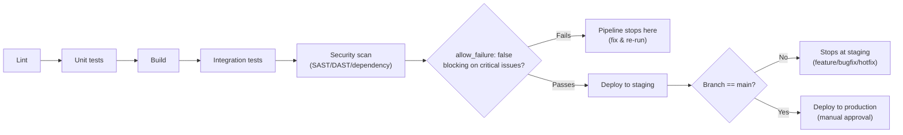

# CI/CD Standards

Authoritative detail behind [README.md § GitLab CI/CD Standards](../README.md#gitlab-cicd-standards). The runnable starter pipelines live at [`.github/workflows/`](../.github/workflows) and [`.gitlab-ci.yml`](../.gitlab-ci.yml); this document is the *why* behind their design.

Treat CI/CD as a platform product: shared templates, explicit control flow, immutable artifacts, and strong environment governance.

## Pipeline Design Principles
- **Fail fast and cheaply**: order stages as `lint` → `unit` → `build` → `integration` → `security` → `staging` → `production` (mirrored in `.gitlab-ci.yml` and the job ordering in `.github/workflows/ci.yml`).
- Use `include`/`extends` (GitLab) for central templates; keep per-service `.gitlab-ci.yml` files thin. This template's `.gitlab-ci.yml` is deliberately standalone (no `include:`) so it works before you have a shared templates project — migrate to `include` once one exists.
- Model dependencies explicitly with a DAG (`needs:` in GitLab, `needs:`/job dependencies in GitHub Actions) and explicit `rules`/`workflow` conditions.
- Differentiate `cache` (restores dependencies between jobs) from `artifacts` (immutable build outputs passed between stages).
- Protect production environments with protected environments, masked/protected CI/CD variables, and a secrets manager (e.g., Vault).
- Enable security scanning (SAST/DAST/dependency scanning, see [governance/security-practices.md](../governance/security-practices.md)) and make it blocking for critical issues.
- Use child pipelines/review apps (GitLab) or PR preview environments (GitHub) for faster feedback.

### Pipeline Diagram



ASCII fallback (same flow, terminal-friendly):

```
Lint ──► Unit ──► Build ──► Integration ──► Security ──► Staging ──► Production
                                             (blocking)   (needs:     (main only,
                                                            integration  manual approval)
                                                            + security)
```

Each stage runs only if the prior one passes (`needs:`/job dependencies above) — a failure stops the pipeline at that stage rather than continuing with a red upstream job.

## Example: `.gitlab-ci.yml` (thin service repo, with shared templates)

Once you have a central `ci-templates` project, migrate the standalone `.gitlab-ci.yml` at the repo root toward this pattern:

```yaml
include:
  - project: platform/ci-templates
    file: node.yml  # central shared jobs (lint, test, build, security)
    ref: v2026.10

workflow:
  rules:
    - if: $CI_PIPELINE_SOURCE == "merge_request_event"
    - if: $CI_COMMIT_BRANCH =~ /^(feature|bugfix|hotfix)\//

stages:
  - lint
  - test
  - build
  - integration
  - security
  - deploy

lint:
  extends: .node_lint

unit_test:
  extends: .node_test

build_image:
  extends: .docker_build
  needs: ["unit_test"]
  artifacts:
    paths: ["dist/"]
    expire_in: 7 days

integration_test:
  extends: .node_integration
  needs: ["build_image"]

security_scan:
  extends: .security_sast_dast
  needs: ["build_image"]
  allow_failure: false

deploy_staging:
  extends: .deploy_k8s
  environment:
    name: staging
  needs: ["integration_test", "security_scan"]
  when: on_success

deploy_prod:
  extends: .deploy_k8s
  environment:
    name: production
    url: https://app.example.com
  needs: ["deploy_staging"]
  rules:
    - if: $CI_COMMIT_BRANCH == "main"
      when: manual
```

Stage ordering, cache vs. artifacts separation, and template/DAG design above follow GitLab CI/CD best-practice guidance.

## GitHub Actions Equivalent

See [`.github/workflows/ci.yml`](../.github/workflows/ci.yml) (lint → test → build), [`build.yml`](../.github/workflows/build.yml) (multi-OS build matrix), and [`security.yml`](../.github/workflows/security.yml) (secret + dependency scanning). The same fail-fast ordering and `needs:` dependency modeling applies via `jobs.<id>.needs`.
