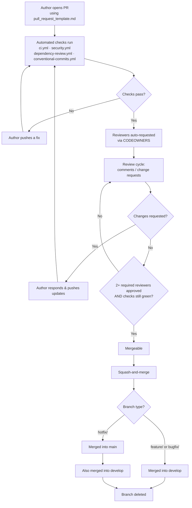

# Code Review Workflow

The practical, step-by-step flow a PR goes through. Policy/requirements — including the industry-standard sources this is built on (Google's Engineering Practices, Conventional Comments) — live in [pr-guidelines/README.md](../pr-guidelines/README.md#industry-recognized-standards); this is the sequence of events.

## Pipeline Diagram



ASCII fallback (same flow, terminal-friendly):

```
Open PR ──► Automated checks ──► Reviewers assigned ──► Review cycle ──► Approval ──► Squash-merge ──► Branch deleted
            (.github/workflows/*) (CODEOWNERS)           (comments/        (2+ required      (develop, or
             │   ▲                                        change requests)  reviewers +         main+develop
             └───┘ fix & re-run                              │  ▲             checks green)     for hotfix/)
                                                               └──┘ author pushes updates
```

Note: a PR left inactive partway through this pipeline gets flagged by `.github/workflows/stale.yml` (see [If Something Goes Wrong Mid-Review](#if-something-goes-wrong-mid-review) below).

## Steps

1. **Author opens the PR** using [.github/pull_request_template.md](../.github/pull_request_template.md), filled out.
2. **Automated checks run** immediately: `ci.yml` (lint/test/build), `security.yml` (secrets/dependencies), `dependency-review.yml`, `conventional-commits.yml`.
3. **Reviewers are auto-requested** via [.github/CODEOWNERS](../.github/CODEOWNERS) based on changed paths.
4. **Review cycle**: reviewers leave comments/change requests; author responds/pushes updates. Target first response within 1 business day (see [pr-guidelines/README.md](../pr-guidelines/README.md)).
5. **Approval**: once required checks pass and the minimum reviewer count approves, the PR is mergeable.
6. **Merge**: squash-and-merge into `develop` (or `main`/`develop` for a `hotfix/`, per [standards/branching-strategy.md](../standards/branching-strategy.md)).
7. **Post-merge**: branch is deleted; if it was a `hotfix/`, confirm it was also merged into `develop`.

## If Something Goes Wrong Mid-Review
- **Check fails after review approval**: re-run or fix; approval doesn't override a failing required check.
- **Reviewers disagree**: escalate per [governance/governance-model.md § Exceptions](../governance/governance-model.md#exceptions).
- **PR goes stale**: `.github/workflows/stale.yml` flags inactive PRs/issues automatically after a configurable period.
